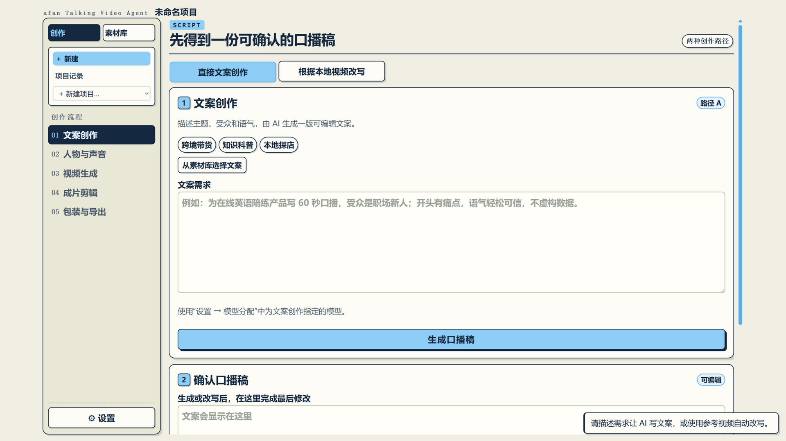
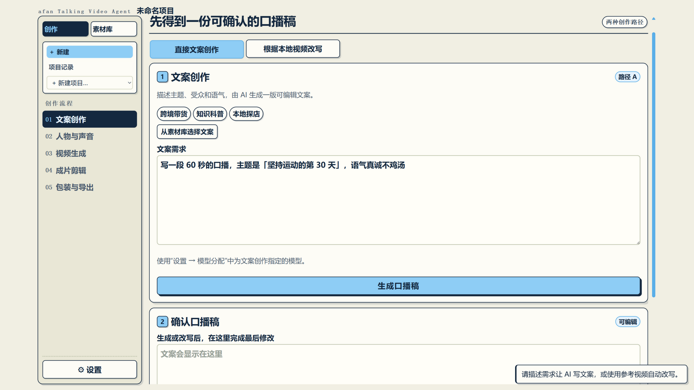
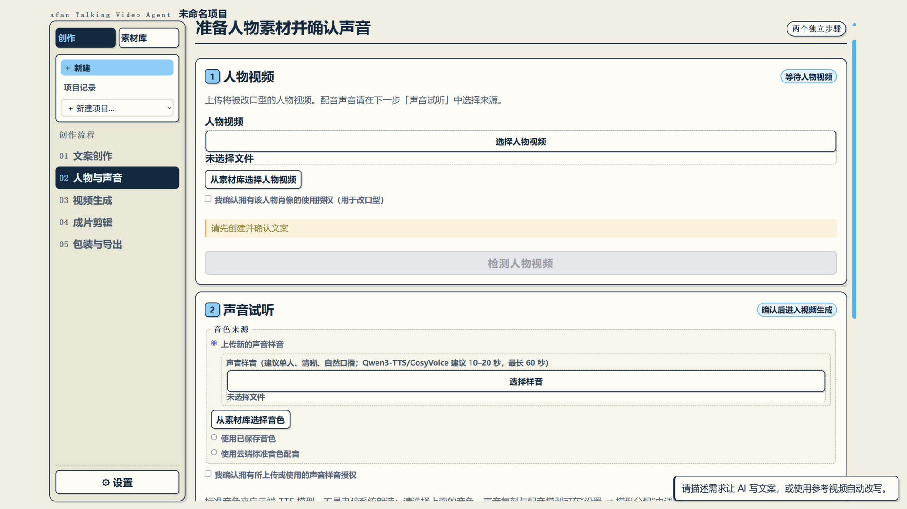
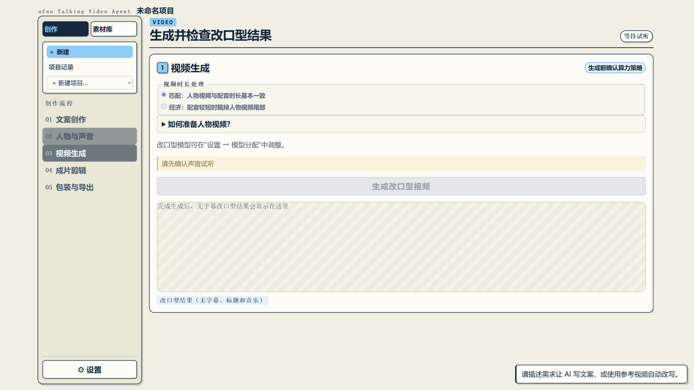
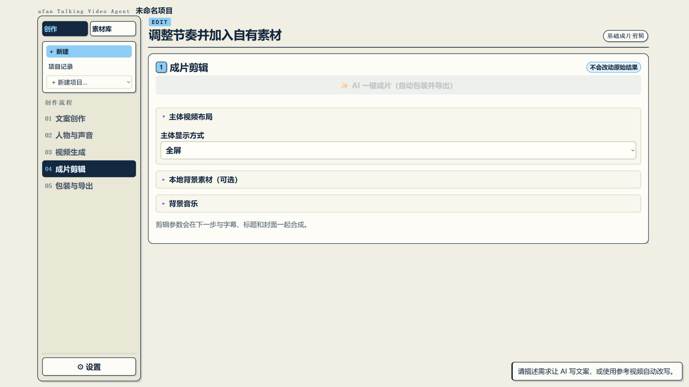
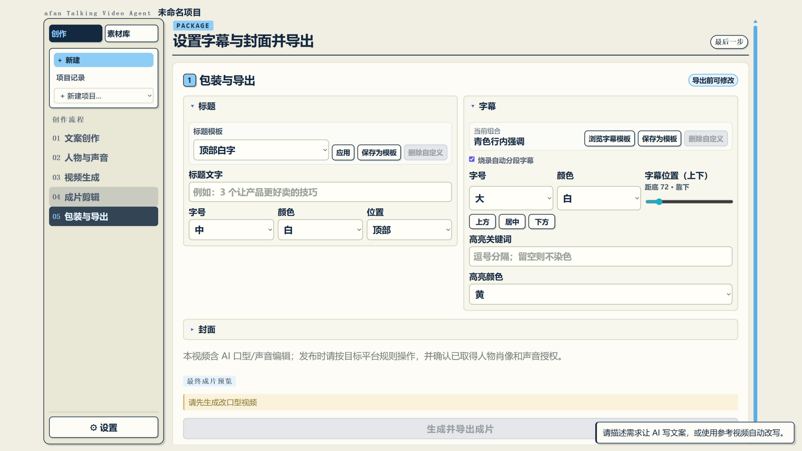

# afan Talking Video Agent 创作教程

从安装完成到导出第一条成片的完整操作教程。截图均为全新安装的初始界面。

> 还没安装？请先阅读 [使用指南](使用指南.md) 完成安装和密钥配置（安装版用户约 5 分钟）。

---

## 界面总览

启动后浏览器自动打开工作台。左侧是**创作流程**（01 文案创作 → 02 人物与声音 → 03 视频生成 → 04 成片剪辑 → 05 包装与导出），跟随编号从上往下走完即可出片。右上角「⚙ 设置」用于配置密钥、模型和数据目录。

> 程序启动后常驻系统托盘（任务栏右下角的青色图标，可能在 `^` 折叠区）。关闭页面不会停止程序；要彻底退出请右键托盘图标 → 「退出」。

---

## 第 1 步：文案创作

1. 左侧确认处于「创作」标签，点 **「+ 新建」** 创建一个项目
2. 在输入框里输入你的主题和要求，例如：
   > 写一段 60 秒的口播，主题是"坚持运动的第 30 天"，语气真诚不鸡汤
3. 点生成，等 AI 写完；不满意可以追加要求让它改写，或直接手动编辑文字
4. 也可以点「从参考视频提取」，上传一条别人的爆款视频，提取文案后生成改写稿

**小提示**：文案会保存到项目里，随时回来改；改完记得点保存。

## 第 2 步：人物与声音

**上传人物视频**（用于改口型）：

1. 点击上传区域，选择一段你**有权使用**的人物视频
2. 要求：单人出镜、正脸、光线充足、时长 ≥10 秒；不要多人同框
3. 勾选「我确认拥有该人物肖像的使用授权」，点「检测人物视频」
4. 检测通过后，此处会显示视频预览

**配置声音**：

1. 试听由 AI 生成的配音：选择音色（用样音复刻你的声音，或使用内置音色）
2. 点「生成试听」，满意后确认进入下一步

> 隐私说明：人物视频保存在你电脑本地的数据目录；只有当改口型步骤选择了云端模型时才会上传处理。想完全不上云，可在「模型分配」里把改口型切到本地 MuseTalk 引擎（需先在设置里接入本地模型包）。

## 第 3 步：视频生成（改口型）

1. 确认文案和人物视频都已就绪
2. 点生成，等待改口型处理——**这一步耗时最长**（云端约 1-3 分钟，本地取决于显卡）
3. 完成后此处播放器可直接预览改口型效果

## 第 4 步：成片剪辑（字幕与包装）

1. **字幕模板**：点开模板选择弹窗，每张卡片实时预览"上方强调文案 + 下方口播字幕"的两层效果，选一个喜欢的
2. **关键词高亮**：字幕里的关键词会按模板配色自动高亮
3. 可选：添加 B-roll 插播、背景音乐、自动生成封面
4. 点导出，程序自动完成字幕烧录和成片合成

## 第 5 步：包装与导出

1. 检查成片预览和自动生成的封面
2. 点「下载」，成片 MP4 会保存到本地
3. 竖屏 9:16 成片可直接发布到抖音、视频号等平台

---

## 常见问题（按报错对照）

| 现象 | 原因与解决 |
| --- | --- |
| 安装新版时提示"无法打开要写入的文件" | 旧版程序还在后台运行。任务管理器结束 afan 进程（或系统托盘右键退出），再重试安装 |
| 托盘右键退出后，浏览器页面还在 | 正常现象：页面已失效会自动提示"本地服务已退出"，手动关闭标签页即可 |
| 生成时提示 `Invalid API-key`（HTTP 401） | 你的 API Key 无效或被重置。到服务商控制台重新创建 Key，在「⚙ 设置」里替换并保存 |
| 生成时提示网络连接失败 / 连接超时 | 临时网络中断。检查网络和代理软件后直接重试 |
| 提示「没有找到输出 MP4」 | 旧版本已知问题，**升级到最新版**即可 |
| 人物视频预处理失败 | 升级到最新版（旧包内嵌 FFmpeg 缺少编码器） |
| 本地人脸预检提示"无法完成" | 不影响使用，按提示确认视频为单人正面即可 |
| 选择文件夹没反应 | 升级到最新版 |
| 改口型想不花钱/不上传云端 | 在「模型分配」把改口型切到本地 MuseTalk 引擎（需按 README 接入本地模型包 + NVIDIA 显卡） |

## 数据与隐私

- 所有项目、素材、密钥保存在本机数据目录（安装版：`%LOCALAPPDATA%\afan Talking Video Agent`），卸载重装不丢失
- 只有你在「模型分配」里选择云端模型的环节，对应素材才会发送给该服务商处理
- 备份整个数据目录即可备份全部项目；API Key 在其中，请勿外传
